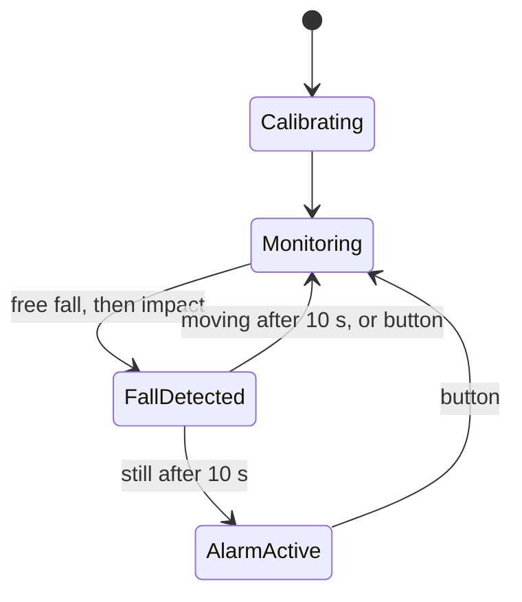

# Fall Detection Smartwatch

ESP32 firmware for a smartwatch prototype that detects when the wearer falls, sounds an alarm, and reports the fall to a cloud backend so a caregiver can be notified.

Made in a five-person team for a university project (spring 2025). This repository holds the device firmware.

## How it works

1. **Calibrate.** At startup the device averages 100 readings from the MPU6050 accelerometer/gyroscope and subtracts these offsets from every later reading.
2. **Monitor.** Every 10 ms it reads the sensor and computes the total acceleration, √(x² + y² + z²).
3. **Detect.** A fall is a moment of free fall (total acceleration drops below a threshold) followed by an impact (a spike above a threshold) within 1 second.
4. **Confirm.** The device waits 10 seconds, then checks whether the wearer is lying still. Half a second of stillness confirms the fall. Movement means it was a false alarm, and monitoring resumes.
5. **Alert.** The LED flashes, the speaker beeps, and a high-priority alert is sent to the backend.
6. **Cancel.** The wearer can press the button at any time during steps 4 and 5 to cancel ("I'm OK").



## Hardware

| Part | Pins |
|---|---|
| ESP32 board (developed on a LilyGO T-Display) | |
| MPU6050 accelerometer/gyroscope | I2C: SDA 21, SCL 22 |
| Push button to GND | GPIO 15 (internal pull-up, interrupt on press) |
| I2S amplifier + speaker | BCLK 26, LRC 27, DIN 25 |
| Status LED | GPIO 2 |

## Cloud connection

At startup the device joins Wi-Fi, requests an auth token, registers itself and downloads its configuration. While monitoring, it uploads its latest readings every 30 seconds as JSON over HTTPS. A confirmed fall is sent right away. If Wi-Fi drops it reconnects, and if the server rejects the token (401/403) it fetches a new one.

| Endpoint (relative to `API_BASE_URL`) | Purpose |
|---|---|
| `GET /get-test-token` | Get a bearer token |
| `POST /DeviceTokens/register` | Register the device |
| `GET /device-config/{deviceId}` | Download device settings |
| `POST /SensorData` | Upload readings and fall alerts |

A fall alert looks like this (`timestamp` is milliseconds since boot):

```json
{
  "deviceId": "ESP32_FALL_001",
  "accel": 9.6,
  "gyro": 3.2,
  "fallDetected": true,
  "timestamp": 734512,
  "emergencyType": "FALL_DETECTED",
  "severity": "HIGH",
  "requiresResponse": true,
  "alertMessage": "Fall detected - immediate assistance may be required",
  "dataJson": { "accel": 9.6, "gyro": 3.2, "deviceId": "ESP32_FALL_001", "detectionTime": 734512 }
}
```

The backend is a REST API hosted on Azure, built as a separate project.

## Build and flash

You need [PlatformIO](https://platformio.org/) (the VS Code extension or the CLI).

1. Copy `include/secrets.example.h` to `include/secrets.h` and fill in your Wi-Fi name, password and API URL. Git ignores `secrets.h`, so your credentials stay local.
2. Set `upload_port` and `monitor_port` in `platformio.ini` to your board's serial port.
3. Build and upload with `pio run -t upload`.
4. Watch the log with `pio device monitor` (115200 baud).

Keep the device flat and still while it calibrates at startup.

## Code layout

| File | What it does |
|---|---|
| `src/main.cpp` | Startup and the main state machine |
| `src/GyroSensor.cpp` | MPU6050 setup, calibration and sampling |
| `src/FallDetection.cpp` | Free-fall and impact detection, stillness check |
| `src/Button.cpp` | Interrupt-driven, debounced cancel button |
| `src/NetworkManager.cpp` | Wi-Fi, token auth, device registration, HTTPS uploads |
| `src/AudioController.cpp` | I2S tone and beep generation for the alarm |
| `include/Config.h` | Pins, thresholds and timings |

## Limitations and next steps

- The thresholds were tuned by hand for demos. Real use needs tuning on recorded falls and everyday movement.
- Uploads and the 2-second stillness check block the main loop while they run. Moving networking to its own FreeRTOS task would keep sampling continuous.
- TLS certificates are not verified (`setInsecure()`). A real device should check the server's certificate.
- The device configuration is downloaded but not applied yet.
- The gyroscope is logged but not used in the fall decision.

## Credits

A teammate wrote the speaker driver (`AudioController`) and connected it in `main.cpp`. The rest of the firmware is mine.
